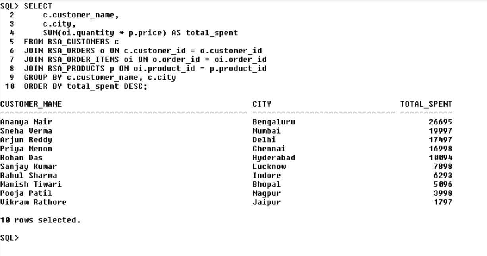
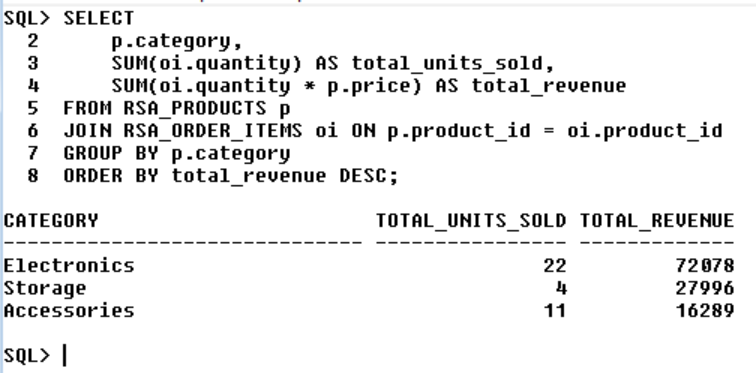
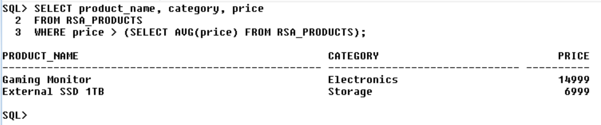
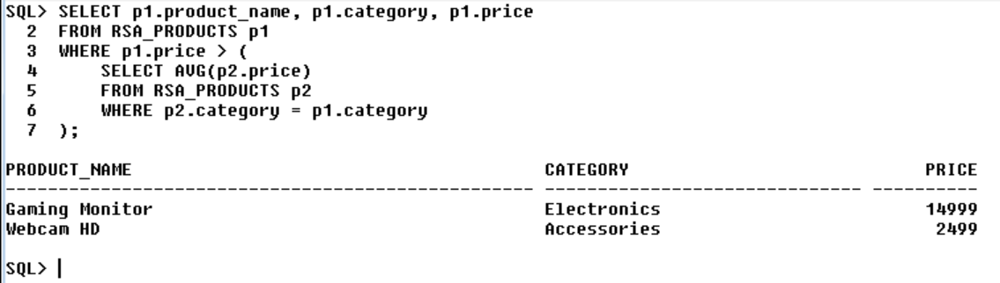

# Retail Sales Analytics (RSA)

SQL project that analyzes retail sales data using joins, aggregate functions
and subqueries.

## Database Schema
4 related tables with Primary & Foreign Keys:
- `RSA_CUSTOMERS` (10 rows)
- `RSA_PRODUCTS` (8 rows)
- `RSA_ORDERS` (18 rows)
- `RSA_ORDER_ITEMS` (25 rows)

## Files
| File | Description |
|------|-------------|
| `1_schema.sql` | Creates tables with PK/FK constraints |
| `2_insert_data.sql` | Inserts sample data |
| `3_queries.sql` | Analytical queries |

## Analysis Performed
1. Customer Lifetime Value (top spenders)
2. Category-wise sales and revenue
3. Products priced above overall average (subquery)
4. Products priced above their category average (correlated subquery)

## How to Run
1. Open Oracle SQL Developer or Oracle Live SQL
2. Run `1_schema.sql`, then `2_insert_data.sql`, then `3_queries.sql`

## Tech Stack
Oracle SQL

## Author
Aniket Daharwal

## Sample Output

### 1. Customer Lifetime Value (Top Spenders)

### 2. Category-wise Sales Performance

### 3. Products Priced Above Overall Average

### 4. Products Priced Above Category Average (Correlated Subquery)

